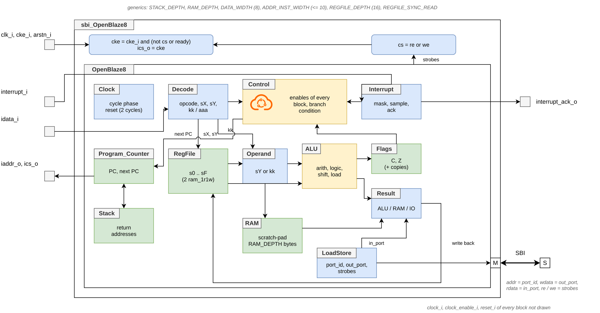
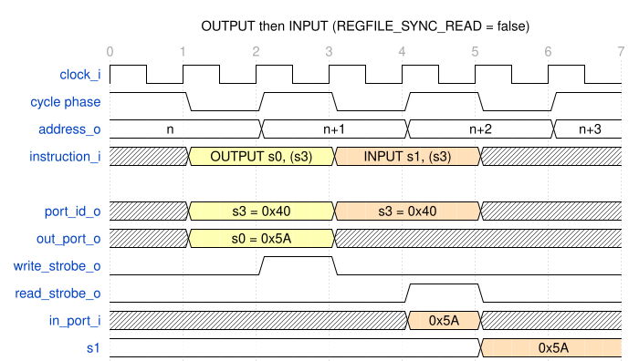
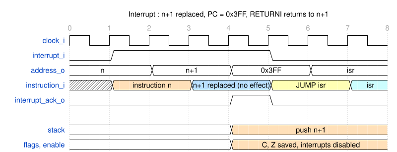

<!--
  README MODEL (common to every Asylum IP, keep the same headings)
  ----------------------------------------------------------------
  Regenerate from the sources, never from the previous README text alone:
    hdl/*.vhd (entities, generics, ports), hdl/csr/*.hjson (register map),
    <IP>.core (VLNV, targets, depends), mk/targets.txt, sim/, syn/, esw/.
  Sections, in this order:
    badges / title + one-line pitch / Overview / Features / Block Diagram /
    Getting Started / Hardware Interfaces / Configuration / Resources /
    Theory of Operation / Registers / Programmer's Guide /
    Design Verification / Dependencies and Related IPs / License
  CPU variant: Instruction Set after Theory of Operation.
  Rules:
    - English, short and factual: every statement backed by the sources.
    - No VLNV line: the version badge shows it.
    - Badges: first line version, license; second line CI, lint, sim, syn;
      third line (CPU) the instruction set.
    - Block diagram: page Overview of doc/<NAME>.drawio, exported to
      doc/<NAME>-Overview.png (make -C doc).
    - Timing diagrams: WaveDrom source doc/<NAME>-<what>.json, rendered
      doc/<NAME>-<what>.svg (make -C doc), shown as images.
    - Registers: link to the generated hdl/csr/<X>_csr.md, never copy the tables.
    - Tables: Configuration = Name|Type|Default|Description,
      Hardware Interfaces = Name|Direction|Type|Description, grouped by interface.
    - A section with nothing to say is one line ("This IP has no
      software-visible registers."), never removed.
-->
[](https://github.com/deuskane/asylum-processor-OpenBlaze8/tags)
[](LICENSE)

[](https://github.com/deuskane/asylum-processor-OpenBlaze8/actions/workflows/ci.yml)
[](https://github.com/deuskane/asylum-processor-OpenBlaze8/actions/workflows/ci.yml)
[](https://github.com/deuskane/asylum-processor-OpenBlaze8/actions/workflows/ci.yml)
[](https://github.com/deuskane/asylum-processor-OpenBlaze8/actions/workflows/ci.yml)

[-blue)](#instruction-set)

# OpenBlaze8

**An 8-bit soft processor in portable VHDL: a cycle-accurate clone of the Xilinx PicoBlaze-3 (KCPSM3), checked in lock-step against the original, with an SBI bus wrapper.**

Part of the [Asylum project](https://github.com/deuskane/asylum-project), a collection of small IP cores, written to be read and learned from.

## Table of Contents

1. [Overview](#overview)
2. [Features](#features)
3. [Block Diagram](#block-diagram)
4. [Getting Started](#getting-started)
5. [Hardware Interfaces](#hardware-interfaces)
6. [Configuration](#configuration)
7. [Resources](#resources)
8. [Theory of Operation](#theory-of-operation)
9. [Instruction Set](#instruction-set)
10. [Registers](#registers)
11. [Programmer's Guide](#programmers-guide)
12. [Design Verification](#design-verification)
13. [Dependencies and Related IPs](#dependencies-and-related-ips)
14. [License](#license)

## Overview

OpenBlaze8 is an academic re-implementation of KCPSM3, the 8-bit micro-controller of the Xilinx PicoBlaze-3, without any vendor primitive. It executes the same 18-bit instructions with the same timing (two clock cycles per instruction) and the same IO port and interrupt behaviour, so a program written for KCPSM3 (assembler in kcpsm3 or pBlazIDE syntax, or C compiled by the PicoBlaze port of SDCC) runs unchanged.

The core, `OpenBlaze8`, has the KCPSM3 port list plus a clock enable. It is split into small blocks (decode, control, ALU, register file, stack, scratch-pad RAM...), one file each, and its memories are the generic `asylum:component:ram` and `asylum:component:stack` cores.

`sbi_OpenBlaze8` puts the IO ports on SBI, the simple bus of Asylum (`port_id` = address, `out_port` = write data, `in_port` = read data) and freezes the core while the addressed target is not ready. It is the 8-bit CPU of [PicoSoC](https://github.com/deuskane/asylum-soc-picosoc).

## Features

- KCPSM3 instruction set: LOAD, AND / OR / XOR, ADD / ADDCY / SUB / SUBCY, COMPARE, TEST, 10 shifts and rotations, INPUT / OUTPUT, FETCH / STORE, JUMP / CALL / RETURN (always, or on Z / NZ / C / NC), RETURNI, ENABLE / DISABLE INTERRUPT
- Two clock cycles per instruction, KCPSM3 timing on every port (checked cycle by cycle against the Xilinx `kcpsm3`)
- 16 registers `s0`..`sF`, ZERO and CARRY flags, saved on interrupt and restored by RETURNI
- Scratch-pad RAM of `RAM_DEPTH` bytes (64 as KCPSM3, up to 256) and CALL / RETURN stack of `STACK_DEPTH` entries (32), the oldest entry overwritten on overflow
- Up to 1024 instructions (`ADDR_INST_WIDTH` <= 10), interrupt vector at the last address
- One interrupt input, `interrupt_ack` output, interrupts disabled at reset
- 256 IO ports; on SBI with `sbi_OpenBlaze8` (wait states through `ready`)
- Clock enable on the whole core; register file read asynchronously (KCPSM3 timing) or synchronously (`REGFILE_SYNC_READ`, block RAM friendly)
- Programs in assembler or C, turned into a ROM by the `pbcc_gen` generator of [asylum-utils-generators](https://github.com/deuskane/asylum-utils-generators)
- Verified with 49 test programs (assembler and C), in lock-step with the original `kcpsm3`, also with random bus stalls

## Block Diagram



Source: [doc/OpenBlaze8.drawio](doc/OpenBlaze8.drawio) (page Overview, exported with `make -C doc`).

- `OpenBlaze8_Decode` splits the instruction into its fields; `OpenBlaze8_Control` decodes the opcode into the enables of every other block, in the phase given by `OpenBlaze8_Clock` (first or second cycle of the instruction).
- `OpenBlaze8_Program_Counter` selects the next PC: PC + 1, the JUMP / CALL target, the top of `OpenBlaze8_Stack` (+ 1 for RETURN, as is for RETURNI) or the interrupt vector.
- `OpenBlaze8_RegFile` reads `sX` and `sY`, `OpenBlaze8_Operand` selects `sY` or the constant `kk`, `OpenBlaze8_ALU` computes the result and the next flags, kept in `OpenBlaze8_Flags`.
- `OpenBlaze8_Result` writes back into `sX` the ALU result, the scratch-pad byte (`OpenBlaze8_RAM`, FETCH) or the input port (`OpenBlaze8_LoadStore`, INPUT). `OpenBlaze8_Interrupt` masks, samples and acknowledges `interrupt_i`.
- `sbi_OpenBlaze8` adds the SBI glue: `cs` = read or write strobe, and the clock enable of the core `cke = cke_i and (not cs or ready)`, also output on `ics_o` for the program memory.

## Getting Started

The cores of the Asylum IPs are published in the FuseSoC library [asylum-cores](https://github.com/deuskane/asylum-cores) (with the UVVM, `kcpsm3` and unisim cores used by the testbench):

```bash
pip install fusesoc
fusesoc library add https://github.com/deuskane/asylum-cores
fusesoc run --target sim_core_test_umul16 asylum:processor:OpenBlaze8  # needs GHDL, picoasm and the PicoBlaze SDCC
```

To use the CPU in your design, add `asylum:processor:OpenBlaze8` to the `depend` list of your core and instantiate `sbi_OpenBlaze8` (library `asylum`) with a program ROM:

```vhdl
library asylum;
use     asylum.sbi_pkg.all;
use     asylum.OpenBlaze8_pkg.all;

  ins_cpu : sbi_OpenBlaze8
    generic map
    ( STACK_DEPTH       => 32
     ,RAM_DEPTH         => 64
     ,DATA_WIDTH        => 8
     ,ADDR_INST_WIDTH   => 10
     ,REGFILE_DEPTH     => 16
     ,REGFILE_SYNC_READ => false
    )
    port map
    ( clk_i           => clk
     ,cke_i           => '1'
     ,arstn_i         => arst_b         -- synchronous to clk
     ,ics_o           => inst_cke
     ,iaddr_o         => inst_addr      -- (9 downto 0)
     ,idata_i         => inst_data      -- (17 downto 0)
     ,sbi_ini_o       => sbi_ini        -- addr / wdata : 8 bits
     ,sbi_tgt_i       => sbi_tgt        -- rdata : 8 bits
     ,interrupt_i     => it
     ,interrupt_ack_o => it_ack
    );

  ins_rom : ROM_user                    -- generated by pbcc_gen
    port map
    ( clk_i           => clk
     ,cke_i           => inst_cke
     ,address_i       => inst_addr
     ,instruction_o   => inst_data
    );
```

The program ROM is generated from an assembler or a C file by the `pbcc_gen` generator of `asylum:utils:generators`: add a `generate` entry to your core and list it in the `generate` of your target. The generator assembles the file with picoasm (C is first compiled by the PicoBlaze port of SDCC) and adds the ROM entity (`entity`, default `OpenBlaze8_ROM`, ports `clk_i`, `cke_i`, `address_i`, `instruction_o`, registered output) and its component package `<entity>_pkg` to your core:

```yaml
generate:
  gen_rom_user:
    generator : pbcc_gen
    parameters:
      file         : esw/user.c          # or a .psm file
      type         : c                   # c, kcpsm3 or pblazeide (assembler syntax)
      entity       : ROM_user
      cflags       : --verbose --all-callee-saves
      logical_name : asylum
```

The generator needs `PICOASM_HOME` (picoasm) and, for C, `PBCC_HOME` (SDCC with the PicoBlaze back-end); both are set in the [asylum-env](https://github.com/deuskane/asylum-ci) image. [PicoSoC](https://github.com/deuskane/asylum-soc-picosoc) is a complete example (CPU, ROM, peripherals and software).

## Hardware Interfaces

### sbi_OpenBlaze8

#### Clock and Reset

| Name | Direction | Type | Description |
|------|-----------|------|-------------|
| `clk_i` | in | std_logic | Clock |
| `cke_i` | in | std_logic | Clock enable of the whole CPU |
| `arstn_i` | in | std_logic | Reset, active low, applied synchronously (inverted into `reset_i` of the core): assert and release it synchronously to `clk_i` |

#### Instructions

| Name | Direction | Type | Description |
|------|-----------|------|-------------|
| `ics_o` | out | std_logic | Enable of the program memory: the clock enable of the core (low while `cke_i` is low or an SBI access waits for `ready`) |
| `iaddr_o` | out | std_logic_vector(ADDR_INST_WIDTH-1 downto 0) | Instruction address (program counter) |
| `idata_i` | in | std_logic_vector(18-1 downto 0) | Instruction, read one cycle after its address (synchronous ROM) |

#### Bus (SBI initiator)

| Name | Direction | Type | Description |
|------|-----------|------|-------------|
| `sbi_ini_o` | out | sbi_ini_t | `cs` = `re` or `we`, `re` = read strobe (INPUT), `we` = write strobe (OUTPUT), `addr` = `port_id`, `wdata` = `out_port` (`DATA_WIDTH` bits each) |
| `sbi_tgt_i` | in | sbi_tgt_t | `rdata` = `in_port`, `ready`: the CPU is frozen while `cs = 1` and `ready = 0` |

#### Interrupt

| Name | Direction | Type | Description |
|------|-----------|------|-------------|
| `interrupt_i` | in | std_logic | Interrupt request, level, sampled on the clock (synchronous to `clk_i`) |
| `interrupt_ack_o` | out | std_logic | Interrupt acknowledge, one cycle |

### OpenBlaze8 (core)

The KCPSM3 port list plus `clock_enable_i`. Vectors use `(N downto 1)` ranges.

| Name | Direction | Type | Description |
|------|-----------|------|-------------|
| `clock_i` | in | std_logic | Clock |
| `clock_enable_i` | in | std_logic | Clock enable |
| `reset_i` | in | std_logic | Reset, active high, synchronous; the core starts 2 cycles after its release, as KCPSM3 |
| `address_o` | out | std_logic_vector(ADDR_INST_WIDTH downto 1) | Instruction address |
| `instruction_i` | in | std_logic_vector(18 downto 1) | Instruction |
| `port_id_o` | out | std_logic_vector(DATA_WIDTH downto 1) | IO port address |
| `in_port_i` | in | std_logic_vector(DATA_WIDTH downto 1) | IO input data, sampled at the end of the read strobe cycle |
| `out_port_o` | out | std_logic_vector(DATA_WIDTH downto 1) | IO output data |
| `read_strobe_o` | out | std_logic | INPUT strobe, second cycle of the instruction |
| `write_strobe_o` | out | std_logic | OUTPUT strobe, second cycle of the instruction |
| `interrupt_i` | in | std_logic | Interrupt request |
| `interrupt_ack_o` | out | std_logic | Interrupt acknowledge |

## Configuration

Generics of `OpenBlaze8` and `sbi_OpenBlaze8` (same names and defaults). The instruction format fixes `DATA_WIDTH`, `REGFILE_DEPTH` and the maximum of `ADDR_INST_WIDTH`: they are checked at elaboration.

| Name | Type | Default | Description |
|------|------|---------|-------------|
| `STACK_DEPTH` | natural | `32` | Entries of the CALL / RETURN stack (interrupts use it too) |
| `RAM_DEPTH` | natural | `64` | Bytes of the scratch-pad RAM (FETCH / STORE), at most 256 |
| `DATA_WIDTH` | natural | `8` | Data width, must be 8 |
| `ADDR_INST_WIDTH` | natural | `10` | Instruction address width, 1 to 10 (1024 instructions) |
| `REGFILE_DEPTH` | natural | `16` | Number of registers, must be 16 |
| `REGFILE_SYNC_READ` | boolean | `false` | `false`: register file read asynchronously, KCPSM3 timing (`port_id` and `out_port` valid during both cycles of INPUT / OUTPUT). `true`: read synchronously (block RAM friendly); `port_id` of an indirect access `(sY)` and `out_port` are only valid during the strobe cycle, so `in_port` must be decoded from `port_id` in that cycle; SBI is not affected (`cs` is only active in that cycle) |

## Resources

Figures of the `syn_*` targets (`make nonreg_syn`, see [Targets](#targets)): `OpenBlaze8` and [syn/sbi_OpenBlaze8_wrapper.vhd](syn/sbi_OpenBlaze8_wrapper.vhd) (`sbi_OpenBlaze8` with flat SBI ports) with the generics of each configuration, synthesized by Yosys and its GHDL plugin; the reports are in the build directory of each target. The program ROM is not included.

| Configuration | LUT¹ | LUTRAM¹ | FF¹ | CARRY4¹ | MUXF7/F8¹ | BRAM¹ | DSP¹ | Area² (µm²) | kGE³ |
|---|---|---|---|---|---|---|---|---|---|
| `syn_core_default` (`OpenBlaze8`, KCPSM3: stack 32, RAM 64, 1024 instructions) | 193 | 28 | 28 | 19 | 23 | 0 | 0 | 39282.68 | 10.465 |
| `syn_core_small` (`OpenBlaze8`, stack 8, RAM 16, 256 instructions) | 191 | 24 | 24 | 16 | 33 | 0 | 0 | 16225.56 | 4.323 |
| `syn_sbi_default` (`sbi_OpenBlaze8`, default generics) | 198 | 28 | 28 | 19 | 23 | 0 | 0 | 39172.57 | 10.436 |
| `syn_sbi_ram256` (`sbi_OpenBlaze8`, RAM 256, synchronous register file, as in PicoSoC) | 200 | 52 | 44 | 19 | 23 | 0 | 0 | 99532.96 | 26.517 |

¹ Xilinx Artix-7 (LUT6), Yosys 0.33 `synth_xilinx -flatten -noiopad -noclkbuf`, before place and route: every cell of the netlist is counted, Vivado may differ. An `INV` counts as a `LUT1`. The register file, the scratch-pad RAM and the stack are in LUTRAM (distributed RAM, asynchronous read), not in BRAM.

² SkyWater sky130 `sky130_fd_sc_hd`, typical corner (tt, 25 °C, 1.80 V), Yosys 0.33 `synth` + `dfflibmap` + `abc -liberty`: standard-cell area only, no timing constraint, no buffering, clock tree or placement; the register file, the scratch-pad RAM and the stack become flip-flops (no SRAM macro), most of the area.

³ Area in thousands of NAND2 gate equivalents (`sky130_fd_sc_hd__nand2_1` = 3.7536 µm²).

## Theory of Operation

### Two cycles per instruction

Each instruction takes two enabled clock cycles. `OpenBlaze8_Clock` toggles the cycle phase; the instruction read at the address of the program counter is decoded in both cycles:

- first cycle: the program counter is written (next instruction, branch target, stack top or interrupt vector), the stack is pushed or popped, the INPUT / OUTPUT strobes are decided;
- second cycle: the register, the flags and the scratch-pad RAM are written, the strobe is high.

The ROM is synchronous: the next address is presented during the second cycle of the current instruction, so that its instruction is ready for the next first cycle.

### IO ports



`port_id` (the constant `pp` or the register `sY`) and `out_port` (`sX`) are valid during both cycles of INPUT / OUTPUT, the strobe only in the second one: a peripheral may register `in_port` from `port_id` (as KCPSM3 allows), the CPU samples `in_port` at the end of the read strobe. With `REGFILE_SYNC_READ = true` the register file output, and so an indirect `port_id` and `out_port`, are only valid during the strobe cycle.

`sbi_OpenBlaze8` maps the strobes on SBI. While `cs = 1` and `ready = 0`, the clock enable of the whole core is low: the access, the program counter and `ics_o` are frozen until `ready = 1`.

### Interrupt



When the interrupts are enabled, `interrupt_i` is registered and taken at the end of the current instruction: the next instruction (n+1) is replaced by one with no effect (no register write, no strobe), its address is pushed on the stack, C and Z are saved, the interrupts are disabled and the program counter jumps to the last address (0x3FF with `ADDR_INST_WIDTH = 10`), where the program puts a JUMP to its handler. `interrupt_ack_o` is high during the second cycle of the replaced instruction. `RETURNI ENABLE` (or `DISABLE`) pops the address without + 1, so instruction n+1 runs after the handler, restores C and Z and enables (or disables) the interrupts.

The interrupts are disabled at reset. `interrupt_i` is a level: hold it until `interrupt_ack_o`, as for KCPSM3; a request that arrives while the interrupts are disabled is taken after `ENABLE INTERRUPT`.

### Stack

The CALL / RETURN stack is an `asylum:component:stack` (`OVERWRITE = 1`, `CYCLIC_PTR = true`) reset by the synchronous reset. A CALL or an interrupt pushes the address of the current instruction; RETURN jumps to the popped address + 1, RETURNI to the popped address (the instruction replaced by the interrupt runs again). A push on a full stack overwrites the oldest entry, a RETURN on an empty stack moves the pointer as KCPSM3 does.

KCPSM3 also writes the current address into the stack entry at its pointer on every instruction (32 entries, 31 levels): after more than 31 nested CALL, or a RETURN on an empty stack, it returns to an address that depends on these writes, which OpenBlaze8 does not reproduce. Programs that stay within 31 levels and never return on an empty stack behave the same.

### Reset and clock enable

`reset_i` is synchronous; the core leaves the reset 2 clock edges after its release, as KCPSM3 (2 flip-flops). These 2 edges are counted whether `clock_enable_i` is high or not: keep the clock enable high during the reset and the 2 cycles after it to start in step with a KCPSM3 clocked by the enabled edges. After that, `clock_enable_i = 0` freezes every register of the core.

## Instruction Set

Instructions are 18 bits, with the encodings of KCPSM3. `opcode = instruction[17:13]`; `instruction[12]` selects the second operand (`1`: register `sY = instruction[7:4]`, `0`: constant `kk = instruction[7:0]`); `sX = instruction[11:8]`; `aaa = instruction[9:0]` (address).

| opcode | Mnemonic (kcpsm3) | Operation | Flags |
|--------|-------------------|-----------|-------|
| `00000` | `LOAD sX, kk / sY` | sX = op2 | - |
| `00010` | `INPUT sX, pp / (sY)` | sX = `in_port`, `port_id` = op2, read strobe | - |
| `00011` | `FETCH sX, ss / (sY)` | sX = RAM[op2] | - |
| `00101` | `AND sX, kk / sY` | sX = sX and op2 | C = 0, Z |
| `00110` | `OR sX, kk / sY` | sX = sX or op2 | C = 0, Z |
| `00111` | `XOR sX, kk / sY` | sX = sX xor op2 | C = 0, Z |
| `01001` | `TEST sX, kk / sY` | sX and op2, not written | C = odd parity, Z |
| `01010` | `COMPARE sX, kk / sY` | sX - op2, not written | C = borrow, Z |
| `01100` | `ADD sX, kk / sY` | sX = sX + op2 | C, Z |
| `01101` | `ADDCY sX, kk / sY` | sX = sX + op2 + C | C, Z |
| `01110` | `SUB sX, kk / sY` | sX = sX - op2 | C = borrow, Z |
| `01111` | `SUBCY sX, kk / sY` | sX = sX - op2 - C | C = borrow, Z |
| `10000` | shift / rotate `sX` | see below (`instruction[3:0]`) | C = bit out, Z |
| `10101` | `RETURN [Z/NZ/C/NC]` | PC = pop + 1 | - |
| `10110` | `OUTPUT sX, pp / (sY)` | `out_port` = sX, `port_id` = op2, write strobe | - |
| `10111` | `STORE sX, ss / (sY)` | RAM[op2] = sX | - |
| `11000` | `CALL [Z/NZ/C/NC,] aaa` | push PC, PC = aaa | - |
| `11010` | `JUMP [Z/NZ/C/NC,] aaa` | PC = aaa | - |
| `11100` | `RETURNI ENABLE / DISABLE` | PC = pop, flags restored, interrupt enable = `instruction[0]` | restored |
| `11110` | `ENABLE / DISABLE INTERRUPT` | interrupt enable = `instruction[0]` | - |

Conditions (`instruction[12:10]`): `0xx` always, `100` Z, `101` NZ, `110` C, `111` NC.

The pBlazIDE syntax (`type: pblazeide`, used by the test programs) names some instructions differently: `COMP`, `ADDC`, `SUBC`, `IN`, `OUT`, `RET`, `RETI`, `EINT` / `DINT`, constants written `$xx`.

| `instruction[3:0]` | Shift | Bit in | `instruction[3:0]` | Shift | Bit in |
|--------------------|-------|--------|--------------------|-------|--------|
| `0110` | `SL0` | 0 | `1110` | `SR0` | 0 |
| `0111` | `SL1` | 1 | `1111` | `SR1` | 1 |
| `0100` | `SLX` | bit 0 | `1010` | `SRX` | bit 7 |
| `0000` | `SLA` | C | `1000` | `SRA` | C |
| `0010` | `RL` | bit 7 | `1100` | `RR` | bit 0 |

Compatibility with KCPSM3: same encodings, same cycle count per instruction, same port and interrupt timing (the testbench compares every port at every cycle with the Xilinx `kcpsm3` netlist). Differences: the stack beyond 31 levels or on a RETURN with an empty stack (see [Stack](#stack)), the clock enable during the 2 cycles after the reset (see [Reset and clock enable](#reset-and-clock-enable)), and the generics (stack, RAM and program sizes, synchronous register file) that KCPSM3 does not have. The register file and the scratch-pad RAM are not reset, as in KCPSM3, but they start undefined (`'U'` in simulation) where the `kcpsm3` model starts with zeros: a program must initialize what it reads.

## Registers

This IP has no software-visible registers.

The programmer-visible state is the CPU state: registers `s0`..`sF`, flags ZERO and CARRY (and their copies for the interrupt), the interrupt enable (disabled at reset), the program counter, the stack and the scratch-pad RAM. The IO ports address the peripherals (the SBI targets with `sbi_OpenBlaze8`).

## Programmer's Guide

An assembler program in pBlazIDE syntax (as the test programs, `type: pblazeide`): it copies the switches (port 0x00) to the LEDs (port 0x20) and counts the interrupts in `s1`. The interrupt vector is the last address (0x3FF with `ADDR_INST_WIDTH = 10`).

```
switch_id           EQU       $00
led_id              EQU       $20

                    ORG       $000
main:
                    LOAD      s1, $00
                    EINT
loop:
                    IN        s0, switch_id
                    OUT       s0, led_id
                    JUMP      loop

isr:
                    ADD       s1, $01
                    RETI      ENABLE

                    ORG       $3FF
                    JUMP      isr
```

The same in C (PicoBlaze SDCC, `type: c`): the IO ports are the array `PBLAZEPORT`, indexed by `port_id` (as [sim/testbench-c/testbench.h](sim/testbench-c/testbench.h)):

```c
#include <stdint.h>

extern char PBLAZEPORT[];                  /* IO ports, PORT_ID = index */

#define PORT_WR(_ADDR_,_DATA_) PBLAZEPORT[(_ADDR_)] = (_DATA_)
#define PORT_RD(_ADDR_)        PBLAZEPORT[(_ADDR_)]

#define SWITCH 0x00
#define LED    0x20

void main()
{
  uint8_t count = 0;

  while (1)
    {
      PORT_WR(LED, PORT_RD(SWITCH) ^ count);
      count++;
    }
}
```

Both examples assemble / compile with the tools of `pbcc_gen` (picoasm, SDCC). The peripheral IPs of Asylum give their register addresses in a C header generated by regtool (`<X>_csr.h`): `pbcc_gen` adds the `*-gen_csr_*` directories of the core to the include path.

## Design Verification

### Testbench

| File | DUT | Description |
|------|-----|-------------|
| [sim/openblaze8/tb_OpenBlaze8.vhd](sim/openblaze8/tb_OpenBlaze8.vhd) | `OpenBlaze8` or `sbi_OpenBlaze8` | Self-checking UVVM testbench, generics `TESTS_LIST` (the programs to run, see below), `MODEL` and `REGFILE_SYNC_READ` (of the DUT). The DUT and the Xilinx reference `kcpsm3` (`xilinx:processor:kcpsm`) run the same program, fetched from the ROM with the address of the reference, and are compared on every falling edge: instruction address, read and write strobes, `interrupt_ack`, `port_id` and `out_port` during each access, and, with `REGFILE_SYNC_READ = false`, `port_id` and `out_port` in the first cycle of the access (KCPSM3 timing). `MODEL = "core"`: `OpenBlaze8`, clock enable high. `MODEL = "sbi"`: `sbi_OpenBlaze8` with random `cke_i` and SBI `ready` (fixed seeds), `kcpsm3` clocked only on the edges where the DUT is expected to be enabled (computed from the reference strobes), `cs` and `ics_o` checked every cycle, `rdata` undefined while `ready = 0`. The bench models 256 IO ports (the switch port 0x00 reads the inverse of the LED port 0x20), an interrupt generator (writing `n` to port 0xFF raises `interrupt_i` `n` cycles later, cleared by `interrupt_ack`), a 32-bit watch value (ports 0xC0..0xC3, printed in the log) and the end of a program: port 0xE0, 0xFA = OK, 0xED = KO. The program ROMs are in [tb_OpenBlaze8_rom](sim/openblaze8/tb_OpenBlaze8_rom.vhd), the names and dispatch in [tb_OpenBlaze8_tests_pkg](sim/openblaze8/tb_OpenBlaze8_tests_pkg.vhd), the IO map, reset pulse and run of a program in [tb_OpenBlaze8_bfm_pkg](sim/openblaze8/tb_OpenBlaze8_bfm_pkg.vhd) |

### Scenarios (`TESTS_LIST`)

A scenario is a test program: the assembler programs of [sim/testbench-asm/](sim/testbench-asm/) (pBlazIDE syntax) and the C programs of [sim/testbench-c/](sim/testbench-c/) (PicoBlaze SDCC, `--all-callee-saves`, IO helpers in [testbench.h](sim/testbench-c/testbench.h)). The core compiles each one with `pbcc_gen` into its own ROM entity `ROM_<name>`; the testbench contains all of them and `TESTS_LIST` selects the programs at run time: names separated by `,` without space (`test_012_add,test_umul16`), a name may be repeated. The sequencer first checks every name (an unknown name is a `TB_ERROR` before any program runs), then for each program selects its ROM, drives a reset pulse (DUT, reference, IO model and interrupt generator), logs `TEST <i>/<N> : <name>` and waits for the OK trigger, at most 10000 cycles (40000 with `MODEL = "sbi"`). The empty list (default) only compiles and elaborates the testbench. The register file and the scratch-pad RAM are not reset: a program initializes what it reads.

Checks are the `=> OK` lines of the log of `sim_core_<name>`: `port_id` / `out_port` of each OUTPUT, `port_id` of each INPUT, each `interrupt_ack`, and the OK trigger. Most programs test their results themselves (conditional jump to the KO trigger), and every cycle is compared with `kcpsm3` (not logged): the Cycles column is the number of cycles from the reset release to the OK trigger, the same as with the original testbench.

| Name | Checks | Cycles | Description |
|------|--------|--------|-------------|
| [`test_000_default`](sim/testbench-asm/test_000_default.psm) | 3 | 7 | JUMP to the OK trigger (at 0x3FC) |
| [`test_001_test_ok`](sim/testbench-asm/test_001_test_ok.psm) | 3 | 5 | OK trigger at address 0 |
| [`test_002_jump`](sim/testbench-asm/test_002_jump.psm) | 3 | 7 | Unconditional JUMP |
| [`test_003_jump`](sim/testbench-asm/test_003_jump.psm) | 3 | 17 | Several unconditional JUMP |
| [`test_004_comp`](sim/testbench-asm/test_004_comp.psm) | 3 | 29 | COMPARE with an immediate, conditional JUMP (Z, NZ, C, NC) |
| [`test_005_comp`](sim/testbench-asm/test_005_comp.psm) | 3 | 39 | COMPARE with a register, conditional JUMP (Z, NZ, C, NC) |
| [`test_006_and`](sim/testbench-asm/test_006_and.psm) | 3 | 91 | AND with a register |
| [`test_007_or`](sim/testbench-asm/test_007_or.psm) | 3 | 103 | OR with a register |
| [`test_008_xor`](sim/testbench-asm/test_008_xor.psm) | 3 | 103 | XOR with a register |
| [`test_009_andi`](sim/testbench-asm/test_009_andi.psm) | 3 | 91 | AND with an immediate |
| [`test_010_ori`](sim/testbench-asm/test_010_ori.psm) | 3 | 103 | OR with an immediate |
| [`test_011_xori`](sim/testbench-asm/test_011_xori.psm) | 3 | 103 | XOR with an immediate |
| [`test_012_add`](sim/testbench-asm/test_012_add.psm) | 3 | 105 | ADD / ADDCY with a register |
| [`test_013_addi`](sim/testbench-asm/test_013_addi.psm) | 3 | 105 | ADD / ADDCY with an immediate |
| [`test_014_sub`](sim/testbench-asm/test_014_sub.psm) | 3 | 117 | SUB / SUBCY with a register |
| [`test_015_subi`](sim/testbench-asm/test_015_subi.psm) | 3 | 117 | SUB / SUBCY with an immediate |
| [`test_016_comp`](sim/testbench-asm/test_016_comp.psm) | 3 | 139 | COMPARE with a register |
| [`test_017_compi`](sim/testbench-asm/test_017_compi.psm) | 3 | 139 | COMPARE with an immediate |
| [`test_018_rl`](sim/testbench-asm/test_018_rl.psm) | 3 | 123 | RL, rotate left |
| [`test_019_rr`](sim/testbench-asm/test_019_rr.psm) | 3 | 123 | RR, rotate right |
| [`test_020_sl0`](sim/testbench-asm/test_020_sl0.psm) | 3 | 109 | SL0, shift left with 0 |
| [`test_021_sl1`](sim/testbench-asm/test_021_sl1.psm) | 3 | 109 | SL1, shift left with 1 |
| [`test_022_sla`](sim/testbench-asm/test_022_sla.psm) | 3 | 161 | SLA, shift left with the carry |
| [`test_023_slx`](sim/testbench-asm/test_023_slx.psm) | 3 | 125 | SLX, shift left with the LSB |
| [`test_024_sr`](sim/testbench-asm/test_024_sr.psm) | 3 | 317 | SR0, SR1, SRA, SRX, shift right |
| [`test_025_call`](sim/testbench-asm/test_025_call.psm) | 3 | 7 | Unconditional CALL |
| [`test_026_call_ret`](sim/testbench-asm/test_026_call_ret.psm) | 3 | 31 | Unconditional CALL and RETURN |
| [`test_027_call_ret`](sim/testbench-asm/test_027_call_ret.psm) | 3 | 63 | Nested CALL and RETURN |
| [`test_028_call_ret_cond`](sim/testbench-asm/test_028_call_ret_cond.psm) | 3 | 99 | Conditional CALL and RETURN |
| [`test_029_fetch_store`](sim/testbench-asm/test_029_fetch_store.psm) | 3 | 67 | FETCH / STORE, direct address |
| [`test_030_fetch_store`](sim/testbench-asm/test_030_fetch_store.psm) | 131 | 1695 | FETCH / STORE, indirect address |
| [`test_031_fetch_store`](sim/testbench-asm/test_031_fetch_store.psm) | 3 | 1571 | FETCH / STORE, indirect address, whole scratch-pad |
| [`test_032_stack_depth`](sim/testbench-asm/test_032_stack_depth.psm) | 3 | 405 | CALL / RETURN stack depth |
| [`test_033_mul`](sim/testbench-asm/test_033_mul.psm) | 3 | 525 | Multiplication routine |
| [`test_034_div`](sim/testbench-asm/test_034_div.psm) | 3 | 431 | Division routine |
| [`test_035_test`](sim/testbench-asm/test_035_test.psm) | 3 | 81 | TEST with a register |
| [`test_036_test`](sim/testbench-asm/test_036_test.psm) | 3 | 71 | TEST with a register |
| [`test_037_in_out`](sim/testbench-asm/test_037_in_out.psm) | 6 | 19 | INPUT |
| [`test_038_in_out`](sim/testbench-asm/test_038_in_out.psm) | 771 | 4105 | 255 OUTPUT / INPUT |
| [`test_039_eint_reti`](sim/testbench-asm/test_039_eint_reti.psm) | 67 | 465 | ENABLE INTERRUPT / RETURNI |
| [`test_040_eint_reti`](sim/testbench-asm/test_040_eint_reti.psm) | 68 | 471 | ENABLE INTERRUPT / RETURNI |
| [`test_041_eint_reti`](sim/testbench-asm/test_041_eint_reti.psm) | 83 | 591 | ENABLE INTERRUPT / RETURNI |
| [`test_042_in_out_indirect`](sim/testbench-asm/test_042_in_out_indirect.psm) | 54 | 507 | Indirect OUTPUT sX, (sY) and INPUT sX, (sY) |
| [`test_043_carry`](sim/testbench-asm/test_043_carry.psm) | 3 | 101 | ADDCY / SUBCY with the carry set, AND / OR / XOR clear the carry |
| [`test_044_reti_flags`](sim/testbench-asm/test_044_reti_flags.psm) | 9 | 105 | RETURNI restores C and Z changed by the handler |
| [`test_045_int_reset`](sim/testbench-asm/test_045_int_reset.psm) | 9 | 193 | Interrupts disabled at reset and by DISABLE, pending interrupt taken after ENABLE |
| [`test_uadd16`](sim/testbench-c/test_uadd16.c) | 27 | 281 | C, 16-bit unsigned addition |
| [`test_udiv16`](sim/testbench-c/test_udiv16.c) | 75 | 1419 | C, 16-bit unsigned division |
| [`test_umul16`](sim/testbench-c/test_umul16.c) | 75 | 3691 | C, 16-bit unsigned multiplication |

### Targets

| Target | Toplevel | Description |
|--------|----------|-------------|
| `default` | `OpenBlaze8` | HDL fileset only (not a simulation) |
| `sim_core` | `tb_OpenBlaze8` | Reference configuration: `OpenBlaze8`, KCPSM3 timing (`REGFILE_SYNC_READ = false`): build and elaboration only (`TESTS_LIST` empty), base of the program targets and of the list runs |
| `sim_core_<name>` | `tb_OpenBlaze8` | One target per program (49 targets, 1486 checks in all) |
| `sim_core_regfile_sync` | `tb_OpenBlaze8` | `OpenBlaze8` with `REGFILE_SYNC_READ = true`, every program (1486 checks) |
| `sim_sbi_regfile_sync` | `tb_OpenBlaze8` | `sbi_OpenBlaze8` with `REGFILE_SYNC_READ = true` (as in PicoSoC), random `cke_i` and `ready`, every program (1486 checks) |
| `lint_ghdl` | `asylum.sbi_OpenBlaze8_wrapper` | GHDL `-Wall` analysis and elaboration of [syn/sbi_OpenBlaze8_wrapper.vhd](syn/sbi_OpenBlaze8_wrapper.vhd) |
| `lint_ghdl_synth_<config>` | `asylum.OpenBlaze8`, `asylum.sbi_OpenBlaze8_wrapper` | `ghdl --synth` check (no latch, synthesizable) of each variant in 2 configurations: `core_default`, `core_small`, `sbi_default`, `sbi_ram256` |
| `syn_<config>` | `asylum.OpenBlaze8`, `asylum.sbi_OpenBlaze8_wrapper` | Synthesis with Yosys, Artix-7 and sky130 (see [Resources](#resources)), same configurations: `syn_core_default`, `syn_core_small`, `syn_sbi_default`, `syn_sbi_ram256` |

The reference configuration of the testbench has a build-only base target and one target per program: one CI job per program, a failure is isolated. The other configurations have one target that runs every program: the `TEST <i>/<N>` header names a failing program. FuseSoC replaces the `parameters` list of an inherited target, so each target repeats the generics of its configuration.

Every `sim_*`, `lint_*` and `syn_*` target is a job of the [GitHub CI](https://github.com/deuskane/asylum-processor-OpenBlaze8/actions/workflows/ci.yml), run in the [asylum-env](https://github.com/deuskane/asylum-ci) image (GHDL, FuseSoC, UVVM, Yosys, picoasm, PicoBlaze SDCC). The `sim`, `lint` and `syn` badges count the passed and failed targets of the last run on `main`.

### How to Run

From a clone of [asylum-project](https://github.com/deuskane/asylum-project) (GHDL, FuseSoC and the PicoBlaze tools installed, or in the asylum-env image):

```bash
make help                        # variables, rules and targets
make sim_core_test_012_add       # one program, log in log/
make sim_sbi_regfile_sync        # every program in a configuration
make nonreg_sim                  # every sim_* target
make nonreg_lint                 # every lint_* target
make nonreg_syn                  # every syn_* target (Yosys, figures of Resources)
make TARGETS_FILTER=eint nonreg_sim
```

To run a list of programs, build the testbench once (every ROM is in it), then run the list without recompiling, with FuseSoC (same `--build-root` and `--no-export` as the Makefile, so that the build of the target is reused; any generic of the target can be overridden after the VLNV):

```bash
make sim_core                    # build and elaboration (TESTS_LIST empty)
fusesoc --cores-root . run --build-root build --no-export --run --target sim_core asylum:processor:OpenBlaze8:2.0.0 --TESTS_LIST=test_041_eint_reti,test_umul16
fusesoc --cores-root . run --build-root build --no-export --run --target sim_core asylum:processor:OpenBlaze8:2.0.0 --TESTS_LIST=test_033_mul --MODEL=sbi --REGFILE_SYNC_READ=true
```

To add a program: the `.psm` (or `.c`) file, its `gen_<name>` entry (with `entity : ROM_<name>`) in the `generate` section and in the `generate` list of `sim_core`, its name in `C_TESTS` and its ROM instance (same position) in `tb_OpenBlaze8_rom`, a `sim_core_<name>` target and the name in the `TESTS_LIST` of the list targets in [OpenBlaze8.core](OpenBlaze8.core), then `make mk/targets.txt` and `make ci_generate`. A program ends with `OUTPUT 0xFA` (OK) or `0xED` (KO) to port 0xE0.

Outside the CI, GHDL writes a waveform `dut.fst`.

## Dependencies and Related IPs

| Core | Repository | Purpose |
|------|------------|---------|
| `asylum:utils:pkg` | [asylum-utils-pkg](https://github.com/deuskane/asylum-utils-pkg) | Common packages (`sbi_pkg`, `math_pkg`); the testbench needs >= 1.10.0 (`string_pkg` lists of `TESTS_LIST`) |
| `asylum:component:ram` | [asylum-component-ram](https://github.com/deuskane/asylum-component-ram) | `ram_1r1w`: register file and scratch-pad RAM |
| `asylum:component:stack` | [asylum-component-stack](https://github.com/deuskane/asylum-component-stack) | CALL / RETURN stack (>= 1.2.0, cyclic pointer and synchronous reset) |
| `asylum:utils:generators` | [asylum-utils-generators](https://github.com/deuskane/asylum-utils-generators) | `pbcc_gen`: test programs to ROM (picoasm, SDCC) |
| `asylum:utils:ghdl_synth` | [asylum-utils-generators](https://github.com/deuskane/asylum-utils-generators) | `ghdl --synth` check of the `lint_ghdl_synth_*` targets |
| `asylum:utils:yosys_synth` | [asylum-utils-generators](https://github.com/deuskane/asylum-utils-generators) | Yosys synthesis of the `syn_*` targets (Artix-7 and sky130) |
| `xilinx:processor:kcpsm` | [xilinx-processor-kcpsm3](https://github.com/deuskane/xilinx-processor-kcpsm3) | Reference `kcpsm3` of the testbench |
| `xilinx:primitive:unisim` | [xilinx-primitive-unisim](https://github.com/deuskane/xilinx-primitive-unisim) | Xilinx primitives of `kcpsm3` (simulation) |
| `bitvis:verification:uvvm` | [UVVM](https://github.com/UVVM/UVVM) | Verification library |

Used by [asylum-soc-picosoc](https://github.com/deuskane/asylum-soc-picosoc). The 32-bit CPU of Asylum: [WardRV](https://github.com/deuskane/asylum-processor-WardRV) (RISC-V). All the IPs: [asylum-project](https://github.com/deuskane/asylum-project).

## License

Apache License 2.0, see [LICENSE](LICENSE).

Exception: the testbench compares the CPU with the Xilinx `kcpsm3` and uses Xilinx unisim primitives; they are not in this repository (cores `xilinx:processor:kcpsm` and `xilinx:primitive:unisim`) and keep their own license (Xilinx). They are only used by the `sim_*` targets and are not part of the IP.
